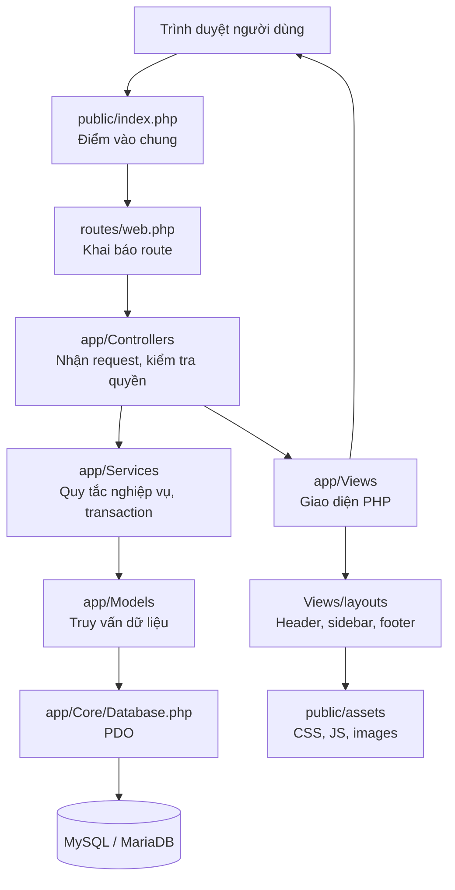

# Kiến trúc hệ thống – Quản lý bán hàng NPP A&D

**Bản thiết kế:** 1.1
**Công nghệ nhóm đã chọn:** PHP thuần, XAMPP (Apache + MySQL/MariaDB), HTML/CSS/JavaScript.

## 1. Kiến trúc đề xuất

Dùng mô hình PHP server-rendered theo hướng MVC đơn giản. Mục tiêu là giữ giao diện, xử lý nghiệp vụ và truy cập dữ liệu tách biệt, để nhiều thành viên làm song song mà ít xung đột.

**Trạng thái hiện tại:** bộ khung đang có `public/index.php`, `routes/web.php`, `app/Core/Database.php`, helper và các view mẫu. `Controllers`, `Models`, `Services` mới là thư mục chuẩn bị cho bước triển khai; chưa nên đặt truy vấn SQL phức tạp hoặc quy tắc cập nhật kho/công nợ trực tiếp trong file View.

## 2. Trách nhiệm từng lớp

| Thành phần | Trách nhiệm | Ví dụ |
|---|---|---|
| `public/index.php` | Điểm vào của ứng dụng, khởi tạo session/cấu hình, điều phối route | Nhận request tạo đơn bán |
| `routes/web.php` | Khai báo tên route, URL/điều kiện và controller tương ứng | `sales.create`, `accounting.reconcile` |
| `app/Controllers/` | Đọc input, xác thực request, gọi service, chọn view/redirect | `SalesOrderController` |
| `app/Services/` | Quy tắc nghiệp vụ và giao dịch nhiều bảng | Giữ tồn khi duyệt đơn; xác nhận xuất kho; lập phiếu thu và phân bổ công nợ |
| `app/Models/` | Truy vấn/ghi dữ liệu bằng PDO prepared statements | `SalesOrder`, `Warehouse`, `Receipt` |
| `app/Core/Database.php` | Tạo kết nối PDO dùng chung | Đọc cấu hình MySQL |
| `app/Views/` | Hiển thị dữ liệu đã được controller/service chuẩn bị | Form đơn hàng, bảng phiếu thu, báo cáo doanh số |
| `app/Views/layouts/` | Khung giao diện dùng lại giữa các màn hình | Header, sidebar, footer |
| `public/assets/` | Tài nguyên tĩnh | CSS dùng chung, JavaScript, hình ảnh |
| `config/` | Cấu hình môi trường | `database.php` không đưa lên Git nếu chứa thông tin nhạy cảm |
| `database/` | DDL và dữ liệu nền | `schema.sql`, `seed.sql` |
| `storage/logs/` | Log lỗi ứng dụng; không lưu mật khẩu/token | Lỗi PDO, lỗi xử lý request |
| `tests/` | Kiểm thử service/quy tắc nghiệp vụ | Tồn kho không âm, phân bổ tiền không vượt dư nợ |
| `docs/` | Tài liệu nghiệp vụ, thiết kế DB, quy ước code | `db-design.md`, Use Case đã thống nhất |

## 3. Các phân hệ

1. **Hệ thống và bảo mật:** tài khoản, nhóm quyền, trạng thái tài khoản, nhật ký hoạt động.
2. **Danh mục:** nhân viên, khu vực, khách hàng, nhà cung cấp, hàng hóa và đơn vị tính.
3. **Bán hàng:** đơn bán → duyệt → phiếu xuất kho xác nhận → hóa đơn bán.
4. **Kho:** tồn theo từng kho, nhập kho, xuất kho, chuyển kho, kiểm kê và nhận hàng trả lại.
5. **Tài chính:** phiếu thu trực tiếp, tiền NVBH thu hộ, đợt nộp tiền, đối soát, phân bổ thu theo hóa đơn; phiếu chi và thanh toán nhà cung cấp.
6. **Báo cáo:** doanh số theo thời gian/NVBH, nhập–xuất–tồn, tồn kho ký gửi, công nợ trong hạn/quá hạn.

## 4. Luồng dữ liệu cốt lõi

### Bán hàng

`don_ban_hang` + `chi_tiet_don_ban_hang` → duyệt đơn/kiểm tra công nợ và tồn khả dụng → `phieu_xuat_kho` + chi tiết thực xuất → khi xác nhận, cập nhật `ton_kho` → lập `hoa_don_ban` và chi tiết. Hóa đơn lấy số lượng từ dòng thực xuất, không mặc định rằng số lượng đặt luôn bằng số lượng thực giao.

### Thanh toán trực tiếp

Kế toán tạo `phieu_thu`, chọn hóa đơn trong `chi_tiet_phieu_thu`; chỉ khi xác nhận phiếu thu mới tính số tiền đã thanh toán vào công nợ.

### Thu hộ qua NVBH

NVBH ghi `phieu_thu_nvbh` → cuối ca lập `dot_nop_tien_nvbh` và các dòng đối chiếu → kế toán kiểm tra số tiền thực nhận → lập `phieu_thu` chính thức và phân bổ vào hóa đơn. Ghi nhận thu hộ ban đầu không tự giảm dư nợ để tránh ghi nhận hai lần.

### Chuyển kho

Lập một `phieu_chuyen_kho` có cả kho xuất và kho nhập, kèm các dòng hàng. Khi xác nhận, trong cùng transaction giảm `ton_kho` tại kho nguồn và tăng tại kho đích.

## 5. Quy tắc kỹ thuật

- Dùng PDO prepared statements; không nối trực tiếp dữ liệu người dùng vào SQL.
- Mật khẩu lưu bằng `password_hash()`; xác minh bằng `password_verify()`.
- Kiểm tra quyền ở phía server, không chỉ ẩn/hiện menu giao diện.
- Những thao tác cập nhật nhiều bảng dùng transaction; lỗi bất kỳ bước nào phải rollback.
- Chứng từ đã xác nhận không sửa/xóa tùy tiện; tạo nghiệp vụ điều chỉnh hoặc hủy theo trạng thái và ghi log.
- Dùng `utf8mb4` nhất quán; HTML có `<meta charset="UTF-8">` và escape dữ liệu bằng helper.
- Tập trung quản lý `schema.sql`; thành viên không tự sửa cấu trúc bảng riêng lẻ mà chưa thông báo người phụ trách CSDL.

## 6. Phân quyền/ownership khi làm nhóm

- **Nhóm trưởng (Đỗ Tiến Đạt):** khung chung, cấu hình DB, tích hợp và phân quyền tài khoản.
- **Phạm Đức Tiến:** đơn hàng bán và luồng duyệt/xuất kho theo phạm vi được giao.
- **Lê Đặng Phương Trinh:** phiếu thu, đối soát tiền NVBH, phân bổ gạch nợ.
- **Đỗ Văn Quang:** kho, chuyển kho và cập nhật tồn.
- **Trần Vũ Anh Khoa:** báo cáo doanh số và truy vấn tổng hợp.

Đây là phân chia khởi đầu theo kế hoạch đã trao đổi; nhóm cần xác nhận đầu việc và đặt người duy trì từng file dùng chung. `schema.sql`, layout chung và CSS nền cần có một người chịu trách nhiệm tích hợp để hạn chế conflict.

## 6. Quy ước tích hợp từ workbook Excel

Workbook bổ sung được dùng làm nguồn đối chiếu các cột danh mục và chứng từ, không phải nguồn seed tự động nguyên trạng. Các mã chứng từ, giá, thuế, ngày và số dư phải được làm sạch/đối chiếu trước khi nhập. Đặc biệt:
- `SlsTax` lưu theo tỷ lệ thập phân trong nguồn (`0.1` = 10%).
- Tồn kho và công nợ trong báo cáo là số liệu tổng hợp; nguồn chuẩn để ghi sổ là các chứng từ đã xác nhận.
- Bán nợ/thu ngay, trả hàng và điều chuyển kho phải được ánh xạ thành luồng/chứng từ riêng, không gộp tất cả vào trường loại hóa đơn.
- Giá trị mã hóa đơn/đơn nhập không khớp giữa một số sheet; nhóm cần đối chiếu mã trước khi nhập giao dịch lịch sử.
